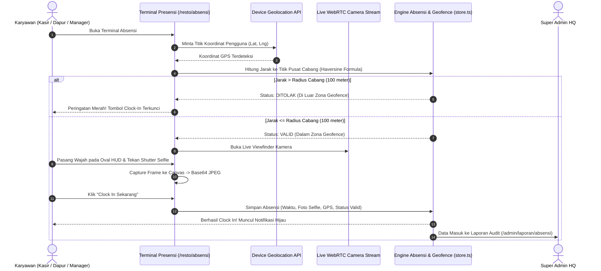
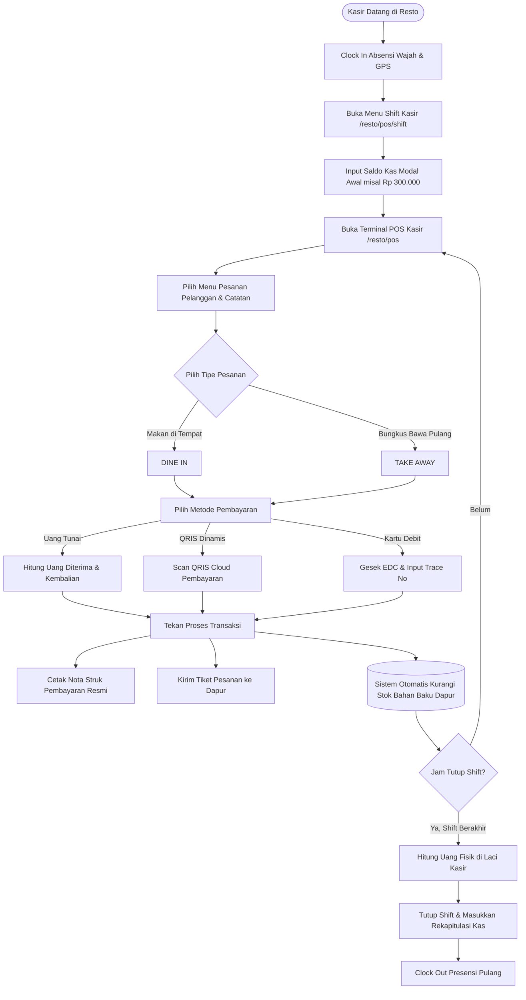
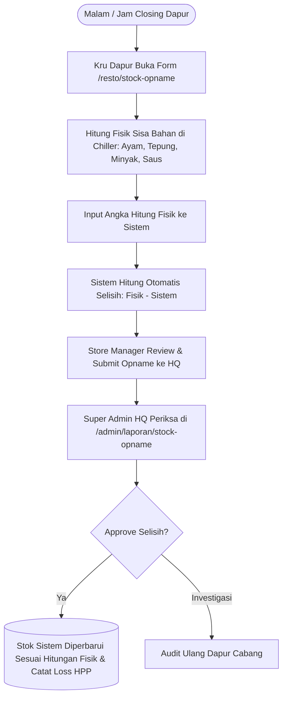

# DOKUMENTASI FLOW PROSES BISNIS & PANDUAN PERAN (SOP)
## SISTEM ENTERPRISE RESTORAN D'BESTO INDONESIA

Dokumen ini merangkum seluruh arsitektur proses bisnis, standar operasional prosedur (SOP) harian, matriks kewenangan hak akses (RACI Matrix), dan panduan antarmuka sistem agar pengguna dari seluruh tingkatan jabatan tidak mengalami kebingungan dalam mengoperasikan aplikasi.

---

## 1. PETA PERAN PENGGUNA (USER PERSONA & SCOPE)

Sistem D'Besto dirancang dengan segregasi tugas (*Separation of Duties*) yang ketat ke dalam 5 peran utama:

```
┌────────────────────────────────────────────────────────────────────────┐
│                        KONSOLIDASI JARINGAN HQ                         │
│                    👑 SUPER_ADMIN (Kantor Pusat)                       │
│  - Multi-Cabang & Geofence    - Otorisasi PO Bahan   - Finansial Global │
└───────────────────────────────────┬────────────────────────────────────┘
                                    │
          ┌─────────────────────────┴─────────────────────────┐
          │                                                   │
┌─────────▼───────────────────────────┐   ┌───────────────────▼───────────────────┐
│     OPERASIONAL CABANG MARGONDA     │   │      OPERASIONAL CABANG TEBET         │
│   🏪 RESTO_ADMIN (Store Manager)    │   │    🏪 RESTO_ADMIN (Store Manager)     │
│   - Supervisi Shift & Kehadiran     │   │    - Supervisi Shift & Kehadiran      │
│   - Pengajuan PO Pasokan Bahan      │   │    - Pengajuan PO Pasokan Bahan       │
│   - Rekonsiliasi Stock Opname       │   │    - Rekonsiliasi Stock Opname        │
└─────────┬───────────────────────────┘   └───────────────────┬───────────────────┘
          │                                                   │
     ┌────┴────────────────────────┐                     ┌────┴────────────────────────┐
     │                             │                     │                             │
┌────▼──────────────┐   ┌──────────▼────────┐   ┌────────▼──────────┐   ┌──────────▼────────┐
│ 💳 CASHIER        │   │ 👨‍🍳 KITCHEN STAFF │   │ 💳 CASHIER        │   │ 👨‍🍳 KITCHEN STAFF │
│ (Kasir Frontline) │   │ (Dapur & Opname)  │   │ (Kasir Frontline) │   │ (Dapur & Opname)  │
│ - Terminal POS    │   │ - Produksi Ayam   │   │ - Terminal POS    │   │ - Produksi Ayam   │
│ - Buka/Tutup Kas  │   │ - Hitung Fisik    │   │ - Buka/Tutup Kas  │   │ - Hitung Fisik    │
│ - Cetak Struk     │   │ - Presensi GPS    │   │ - Cetak Struk     │   │ - Presensi GPS    │
└───────────────────┘   └───────────────────┘   └───────────────────┘   └───────────────────┘

┌────────────────────────────────────────────────────────────────────────┐
│                        PORTAL PUBLIK / KONSUMEN                        │
│                 👥 PUBLIC (Pelanggan & Calon Mitra)                    │
│  - Eksplorasi Menu & Promo    - Cari Cabang    - Franchise Franchise   │
└────────────────────────────────────────────────────────────────────────┘
```

---

## 2. DIAGRAM ALUR PROSES BISNIS UTAMA (BUSINESS FLOWCHARTS)

### A. Alur Presensi Karyawan (GPS Geofence + Biometric Face Verification)

Presensi mencegah kecurangan absensi (*anti-titip absen / fake GPS*) dengan mengombinasikan verifikasi koordinat bumi dan biometrik selfie:



---

### B. Alur Transaksi Kasir POS & Pengurangan Stok Dapur



---

### C. Alur Pengadaan Bahan Baku (PO Cabang -> Approval Gudang HQ -> Penerimaan)

```mermaid
flowchart LR
    subgraph Cabang Resto [Store Manager Cabang]
        A1[Cek Batas Stok Kritis] --> A2[Input Request PO Bahan /resto/po-bahan-baku]
        A2 --> A3[Status PO: SUBMITTED]
    end

    subgraph Kantor Pusat [Super Admin HQ]
        A3 --> B1[Audit Kebutuhan Bahan Cabang]
        B1 --> B2{Otorisasi PO?}
        B2 -->|Tolak| B3[Status: REJECTED]
        B2 -->|Setujui| B4[Status: APPROVED]
        B4 --> B5[Gudang HQ Kemas & Kirim Muatan]
        B5 --> B6[Status: SHIPPED]
    end

    subgraph Penerimaan Resto [Cabang Resto Fisik]
        B6 --> C1[Truk Logistik Tiba di Resto]
        C1 --> C2[Kru Dapur & Manager Cek Fisik Barang]
        C2 --> C3[Upload Foto Bukti GRN & Konfirmasi Terima]
        C3 --> C4[Status: RECEIVED]
        C4 --> C5[(Stok Inventaris Cabang Bertambah Otomatis)]
    end
```



---

### D. Alur Stock Opname Harian/Mingguan (Physical Inventory Count)



---

## 3. MATRIKS HAK AKSES PERAN (RACI PERMISSION MATRIX)

Keterangan:
- **R (Responsible):** Pelaksana tugas utama
- **A (Accountable):** Penanggung jawab & pengambil keputusan akhir
- **C (Consulted):** Memberikan masukan atau supervisi
- **I (Informed):** Menerima notifikasi atau melihat laporan

| Modul & Fitur Aplikasi | SUPER_ADMIN (HQ) | RESTO_ADMIN (Manager) | CASHIER (Kasir) | STAFF (Dapur) | PUBLIC (Konsumen) |
|---|:---:|:---:|:---:|:---:|:---:|
| **Dashboard Eksekutif HQ & KPI Global** | **A / R** | I | - | - | - |
| **Master Cabang Resto & Radius Geofence** | **A / R** | I | - | - | - |
| **Master Akun Karyawan & Role** | **A / R** | C | - | - | - |
| **Katalog Resep Menu & Bahan Baku** | **A / R** | I | I | I | I (Menu saja) |
| **Terminal POS Kasir (Order & Bayar)** | C | A / C | **A / R** | - | - |
| **Buka / Tutup Shift Laci Kasir** | I | C | **A / R** | - | - |
| **Presensi Selfie Wajah & Radar GPS** | A (Audit) | C (Supervisi) | **R (Mandiri)** | **R (Mandiri)** | - |
| **Request PO Bahan Baku ke Gudang** | C | **A / R** | - | C | - |
| **Otorisasi & Approval PO Gudang HQ** | **A / R** | I | - | - | - |
| **Input Hitung Fisik Stock Opname** | I | A | - | **R (Dapur)** | - |
| **Validasi & Approval Stock Opname** | **A / R** | I | - | - | - |
| **Laporan Omzet Harian Cabang** | A | **R** | I (Shift) | - | - |
| **Laporan Finansial Konsolidasi HQ** | **A / R** | - | - | - | - |
| **Formulir Kemitraan Franchise** | **A / R** | - | - | - | **R (Pelamar)** |

---

## 4. STANDAR OPERASIONAL PROSEDUR (SOP) KRONOLOGIS HARIAN

### A. SOP Super Admin (Kantor Pusat HQ)
1. **Pagi (08:00 - 09:00 WIB):**
   - Buka `/admin` -> Pantau log absensi di `/admin/laporan/absensi` untuk memastikan semua cabang telah buka dengan staf lengkap.
   - Cek radar geofence jika ada peringatan staf absen di luar radius cabang.
2. **Siang (09:00 - 12:00 WIB):**
   - Buka `/admin/laporan/po-bahan-baku` -> Tinjau pesanan bahan baku yang masuk dari cabang.
   - Setujui (Approve) PO cabang yang valid agar tim gudang logistik HQ segera menyiapkan pengiriman.
3. **Sore (13:00 - 16:00 WIB):**
   - Buka `/admin/laporan/stock-opname` -> Audit selisih stok bahan di cabang-cabang resto.
   - Setujui penyesuaian stok opname jika selisih dalam batas toleransi wajar.
4. **Malam (21:30 WIB - Selesai):**
   - Buka `/admin/laporan/pemasukan` -> Analisis total pendapatan omzet seluruh cabang hari ini, evaluasi rasio metode bayar Cash vs QRIS, dan pencapaian target bulanan.

---

### B. SOP Store Manager (Kepala Cabang Resto)
1. **Pagi (08:30 WIB):**
   - Datang ke resto, lakukan selfie presensi Clock In di `/resto/absensi`.
   - Cek kehadiran kru kasir dan kru dapur di `/resto/absensi/riwayat`.
2. **Pagi (09:00 WIB):**
   - Cek persediaan bahan baku di cold storage dan kitchen cabinet.
   - Buat pengajuan pesanan bahan di `/resto/po-bahan-baku` jika stok mendekati batas minimum.
3. **Pagi (09:30 WIB):**
   - Supervisi kasir saat menghitung kas modal awal di `/resto/pos/shift`.
4. **Siang - Sore (11:00 - 17:00 WIB):**
   - Pantau antrean kasir dan kelancaran penyajian di terminal kasir `/resto/pos`.
   - Jika pasokan dari gudang HQ tiba, dampingi kru dapur memeriksa fisik barang dan lakukan konfirmasi terima.
5. **Malam (21:30 WIB / Closing):**
   - Dampingi kru dapur menghitung fisik stok bahan baku di `/resto/stock-opname`.
   - Submit laporan stock opname ke HQ.
   - Verifikasi penutupan kas shift kasir dan cetak rekapitulasi omzet di `/resto/laporan`.

---

### C. SOP Kasir (Cashier Frontline)
1. **Datang (08:45 WIB):**
   - Berdiri di counter kasir, buka `/resto/absensi`.
   - Izinkan kamera & GPS, pastikan indikator hijau *"VALID (≤ 100m)"*, ambil foto selfie wajah tersenyum dan tekan *"Clock In Sekarang"*.
2. **Sebelum Layanan (09:00 WIB):**
   - Buka `/resto/pos/shift`, klik *"Buka Shift Kasir"*, pastikan uang receh modal awal Rp 300.000 sudah ada di laci kas.
3. **Jam Layanan (09:00 - 21:00 WIB):**
   - Buka `/resto/pos`.
   - Sambut pelanggan ramah: *"Selamat datang di D'Besto! Mau pesan apa hari ini?"*
   - Input pesanan, tawarkan promo paket hemat, pilih metode pembayaran, terima uang atau verifikasi QRIS, tekan proses dan serahkan nota struk resmi.
4. **Closing (21:15 WIB):**
   - Buka `/resto/pos/shift`, hitung seluruh lembaran uang fisik di laci kasir.
   - Klik *"Tutup Shift"*, masukkan nominal uang fisik yang dihitung, setor uang ke Store Manager.
5. **Pulang (21:30 WIB):**
   - Buka `/resto/absensi` dan lakukan selfie *"Clock Out"* untuk mengakhiri shift resmi.

---

### D. SOP Kru Dapur (Kitchen & Produksi)
1. **Datang (08:30 WIB):**
   - Buka `/resto/absensi` dan lakukan selfie Clock In di area dapur resto.
2. **Preparasi Dapur (08:45 WIB):**
   - Cuci tangan higienis, nyalakan deep fryer (suhu standar 170°C).
   - Keluarkan ayam marinasi bumbu rempah dari chiller, siapkan tepung bumbu krispi dan saus sadas.
3. **Pengolahan (09:00 - 21:00 WIB):**
   - Balur ayam dengan teknik penepungan ganda untuk kerenyahan maksimal.
   - Masukkan ke deep fryer selama 12-14 menit hingga berwarna kuning keemasan.
   - Simpan di etalase penghangat (*food warmer cabinet*) dengan suhu minimal 65°C.
4. **Closing & Stock Opname (21:00 WIB):**
   - Buka `/resto/stock-opname`, hitung jumlah potong ayam sisa, sisa kilogram tepung, minyak goreng, dan kardus kemasan.
   - Input angka fisik ke form dan serahkan ke Store Manager.
   - Saring minyak, bersihkan deep fryer dan meja dapur, matikan regulator gas.
5. **Pulang (21:30 WIB):**
   - Lakukan Clock Out di terminal `/resto/absensi`.

---

## 5. PANDUAN DESAIN ANTARMUKA AGAR PENGGUNA TIDAK BINGUNG

Untuk mencegah kebingungan staf yang baru bergabung atau berpindah cabang, sistem dilengkapi prinsip UI/UX berikut:

1. **Tombol "Panduan Flow Bisnis" di Header Utama:**
   - Tombol berwarna amber mencolok tersedia di header [AdminLayout](file:///e:/Projects/dbesto/src/app/admin/layout.tsx) dan [RestoLayout](file:///e:/Projects/dbesto/src/app/resto/layout.tsx).
   - Mengklik tombol ini memunculkan modal interaktif `RoleWorkflowGuide` yang menampilkan seluruh SOP harian dan tombol pintasan langsung (*direct action*) tanpa meninggalkan halaman kerja saat ini.

2. **Stepper Alur Kerja di Setiap Dashboard Peran:**
   - Halaman `/admin` secara dinamis menampilkan kartu alur harian (Langkah 1 s/d 5) yang relevan untuk Super Admin, Store Manager, Kasir, atau Dapur. Setiap kartu memiliki tombol pintas ke modul terkait.

3. **Indikator Status Kontekstual yang Jelas:**
   - **Badge Role:** Warna khusus untuk setiap role (Kuning untuk HQ, Biru untuk Manager, Merah untuk Kasir, Hijau untuk Dapur).
   - **Indikator Shift:** Badge hijau *"Shift Kasir Buka"* atau merah *"Shift Tertutup"* selalu terpampang di header resto.
   - **Indikator Radius GPS:** Lingkaran radar geofence hijau jika staf berada dalam batas aman 100m, atau merah jika di luar jangkauan.

4. **Navigasi Terfilter Berdasarkan Kewenangan:**
   - Pengguna kasir hanya melihat menu POS, Shift, dan Absensi mereka sendiri.
   - Kru dapur hanya melihat Stock Opname dan Absensi.
   - Store Manager melihat operasional cabang mereka.
   - Super Admin memiliki akses konsolidasi menyeluruh.
